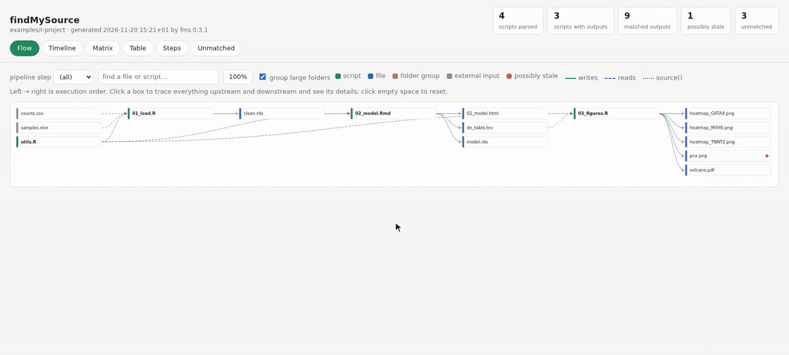
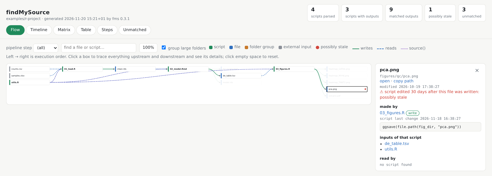
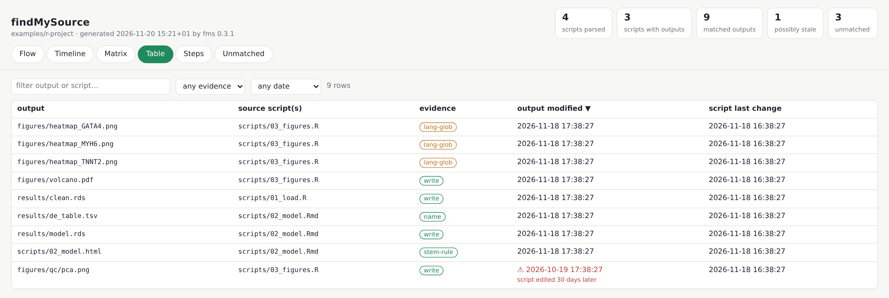
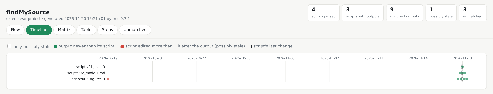

<p align="center">
  
</p>

<h1 align="center">findMySource</h1>

<p align="center">
  <b>Every file has an origin story. <code>fms</code> tells it.</b><br>
  Trace every output of a project back to the script that made it.
</p>

<p align="center">
  
  
  
</p>

---

<p align="center">
  
  <br><sub>The report for <a href="examples/r-project">examples/r-project</a>: one click on a figure shows the script and line that made it, and that it is out of date.
  <a href="https://alexg9010.github.io/findMySource/example-report/">Open the live example report</a>.</sub>
</p>

Coming back to an analysis after months away, or preparing a figure for a paper,
you often need to answer: *which script produced this file, from which inputs,
and is it still up to date?* `findMySource` (`fms` on the command line) scans
your scripts and output folders, matches the two up, and writes a report into `.fms/` in the project:

- `.fms/manifest.tsv`: one row per output file, with its source script(s),
  match confidence, the line of code behind the match, creation and modification dates,
  and the inputs of those scripts.
- `.fms/index.html`: an interactive report you can open in any browser, also offline:
  - **Flow**: a left-to-right map of the pipeline. Click a box to highlight
    everything upstream and downstream of it, and to see its details: the script that
    wrote it, the line of code that links the two, dates, and inputs. Folders with many
    files can be shown as one box or as individual files.
  - **Timeline**: when each output was last written, compared with its script's
    last change. An output is flagged as possibly stale when its script was edited more
    than an hour after the output was written. The table and timeline can filter for these.
  - **Matrix**: which scripts write into which folders.
  - **Table**: a searchable, sortable version of the manifest. Click a row to show it in Flow.
  - **Steps**: an overview with one box per pipeline step (script folder). Arrows show
    which step reads files written by another. Click a step to expand it into its scripts,
    and click a script to open it in Flow.
  - **Unmatched**: a folder tree of the output files no script could be linked to,
    which shows what to add to `exclude` in `fms.json`.
- `.fms/graph.json`: the same graph, for your own tooling.

<details>
<summary><b>More screenshots</b>: Flow, Table and Timeline</summary>

**Flow**: clicking a figure highlights everything upstream of it; the details panel shows the line of code
that wrote it and warns that its script changed later.



**Table**: every output with its script, the kind of evidence for the match, and its dates.
The stale figure is flagged in red.



**Timeline**: one row per script. Dots are its outputs, the black tick is the script's last change.
A red dot left of the tick is an output written before the script was edited.



<sub>Regenerate these, the animation and the live example report with <code>uv run docs/screenshots.py</code>.</sub>
</details>

`fms` needs no running pipeline, no workflow manager and no changes to your
code. It reads what is already there.

## Install

`fms` is a single pure-Python package with **no dependencies** (Python ≥ 3.8).

**pip**
```bash
pip install git+https://github.com/alexg9010/findMySource
```

**uv**
```bash
uv tool install git+https://github.com/alexg9010/findMySource   # puts `fms` on your PATH
uvx --from git+https://github.com/alexg9010/findMySource fms    # one-off run, nothing installed
```

**From source**
```bash
git clone https://github.com/alexg9010/findMySource
cd findMySource
pip install -e .          # or: uv tool install -e .
```
An editable install (`-e`) picks up changes to the code without reinstalling.

## Use

Run it from the root of the project you want to map:

```bash
fms                        # scan: uses ./fms.json if present, else scans the current folder
fms --config fms.json --out my-report   # another report folder
```

This prints a short summary and the path of the report; open `.fms/index.html` in a browser.
A rerun reads only scripts that changed (`.fms/cache.json`), and when nothing changed at all it
keeps the report as it is.

- `.fms/` holds a `.gitignore` that ignores the folder itself, so the report is never committed.
- If the project folder (or its `.fms/`) is not writable, e.g. a colleague's shared project, the report
  goes to `~/.cache/fms/<project>-<hash>/` (or `$XDG_CACHE_HOME/fms/...`) instead. Queries read the
  newest report wherever it is.
- Projects scanned by fms before 0.3 keep their `fms-report/` folder. Delete it to move to `.fms/`.

**Project on a remote machine** (a cluster, a server): `fms --serve` rescans, then serves the report at
http://127.0.0.1:8000/ (`fms --serve 8001` for another port). It listens on localhost only, not on the network; view it through a forwarded port:

- VS Code Remote-SSH forwards the port by itself when the URL appears in the terminal; click it.
- Plain SSH: `ssh -L 8000:localhost:8000 cluster`, then open http://localhost:8000 locally.
- Or skip the server: `index.html` is a single self-contained file that works offline, so you can
  download it (`scp`, or Download in VS Code) and open it locally, or send it to a colleague. It is a snapshot:
  it does not change when you rescan.

Afterwards, ask about single files or folders. These read the last scan, so they are instant,
and they work from any subfolder of the project:

```bash
fms figures/umap.pdf       # where did it come from: script, code line, dates, upstream chain
fms scripts/02_model.Rmd   # what does this script write and read
fms figures                # which outputs in this folder are possibly stale (exit code 1 if any)
fms .                      # ... in the whole project
```

```
$ fms figures/qc/pca.png
figures/qc/pca.png
  modified 2026-10-20T12:56:11+02:00  ⚠ possibly stale: script edited 30.0 days later
  <- scripts/03_figures.R  (write, script last change 2026-11-19T11:56:11+01:00)
       ggsave(file.path(fig_dir, "pca.png"))

upstream:
  figures/qc/pca.png  <- scripts/03_figures.R ⚠
    results/de_table.tsv  <- scripts/02_model.Rmd
      results/clean.rds  <- scripts/01_load.R
        data/raw/counts.csv  (raw input)
        data/raw/samples.xlsx  (raw input)
```

### Configuration (`fms.json`, optional)

```json
{
  "scripts": ["scripts", "analysis", "notebooks"],
  "outputs": ["results", "figures", "data"],
  "aliases": { "/local": "/data/local" },
  "exclude": ["*.RData", "*_cache"],
  "hidden": false,
  "extensions": [".r", ".rmd", ".qmd", ".ipynb"]
}
```

| key | meaning | default |
|---|---|---|
| `scripts` | folders (or single files) to search for scripts | `["."]` |
| `outputs` | folders to search for output files; symlinks listed here are followed | `["."]` |
| `aliases` | path prefixes that mean the same place, e.g. a mount visible as both `/local` and `/data/local`. Symlinks are resolved automatically and need no alias, and so are paths into another copy of the project: `/home/colleague/myproject/out/x.pdf` counts as `out/x.pdf` when the project folder is also called `myproject` and the colleague's folder does not exist here. A configured alias takes precedence. | `{}` |
| `exclude` | file and folder name globs to skip | RStudio, cache and editor files; for scripts also `build` and `dist` (packaging copies) |
| `hidden` | also scan hidden folders (`.git`, `.snakemake`, …). A hidden folder listed in `scripts`/`outputs` is always scanned. | `false` |
| `extensions` | script types to parse | all types listed under [How it works](#how-it-works) |

### Large projects

Every scan checks every file under `outputs`, so time grows with the number of files:
roughly 2.5 s for an unchanged rerun and 6 to 8 s for a full scan of 100,000 files.
Most of these are usually raw data or tool output that no script of yours writes.
The **Unmatched** tab shows which folders they are. Skip them to make every run near-instant:

```json
{
  "outputs": ["results", "figures", "/data/project"],
  "exclude": ["*.RData", "*_cache", "04_mapping", "imputation_reference", "*.bam", "*.bai"]
}
```

`exclude` matches file and folder *names* anywhere under `outputs`. Setting it replaces the
default list, so keep the defaults you need. Log files can be skipped the same way (`"*.log"`),
but only if your scripts don't write logs you care about: those are often matched, and they
record how an output was made.

## How it works

`fms` doesn't need to know your language's save functions. It reads scripts as text.

1. **Find paths.** Every string literal is a candidate, including f-strings,
   `${var}`, `glue()` and `.format()`. Paths are assembled from variables and
   from joins recognised by their shape: `file.path()`, `os.path.join()`,
   `Path(...)`, the `/` operator, `paste0()` and `sprintf()`.
   - Variables are followed in script order.
   - A script inherits the variables of files it `source()`s or imports, such as `config.py` or `utils.R`.
   - Parts that can only be known at run time, such as a loop variable, become wildcards:
     `f"{FIGURES}/hist_{feature}.svg"` becomes `figures/hist_*.svg`.
2. **Decide the direction** from the name of the call that holds the path, in any language:
   - *save, write, dump, export, `to_…`* → **write**
   - *read, load, open, import, include* → **read**
   - an `open()` mode such as `"w"` overrides the name.
   - Anything else is a weaker **mention**.
3. **Resolve paths.**
   - Relative paths are tried against the script's folder and the project root.
   - Symlinks and aliases are resolved, so that `results/x.rds` and `/data/…/x.rds` count as the same file.
4. **Match and rank.** Every output file found on disk is linked to the scripts with
   the **strongest** evidence for it:

   | evidence | meaning |
   |---|---|
   | `write` | writes to exactly this path |
   | `stem-rule` | rendered report (`analysis.html`) next to its `analysis.Rmd` / `.qmd` / `.ipynb` |
   | `name` | passes this file name to a writing function, e.g. `save_table(df, "de_table")` |
   | `write-glob` | writes to a path that matches only through wildcards |
   | `lang-write` | language-specific fallback, currently R: a known write function without a write verb in its name, such as `pdf()` and `png()` |
   | `lang-glob` | R fallback: a known write function such as `png()`, matched through wildcards |
   | `chunk-folder` | in `analysis_files/` next to `analysis.Rmd` / `.qmd` / `.ipynb`, where knitr and Quarto put chunk figures |
   | `mention` | the path appears in the script, but no read or write was recognised |
   | `mention-glob` | the path appears with wildcards, but no read or write was recognised |

   A script that *reads* a file is not reported as its source, unless it also writes it (a cache, say).
5. **Date.**
   - An output's date is its file modification time.
   - A script's date is its last git commit, or its file time if it has uncommitted changes.
   - Dates are written in local time with their UTC offset, e.g. `2026-11-19T12:05:00+01:00`.
   - The report folder itself is never scanned.
     An output is flagged as possibly stale when its script changed more than an hour after it.

Scripts are recognised by extension. The default list covers R, R Markdown, Quarto, Python,
Jupyter, shell, Snakemake, Julia, Nextflow, Perl and MATLAB, plus files named `Snakefile`
and `Makefile`. Set `extensions` in `fms.json` to change it.

### Limits

- This is static analysis. A file whose name is fully computed at run time,
  or passed in as a command-line argument, can only be matched through wildcards, or not at all.
- Variables are inherited one level deep. If `a.R` sources `b.R`, which sources `c.R`,
  then `a.R` gets the variables of `b.R` only.

## Roadmap

- Rule-aware Snakemake/Nextflow support (inputs and outputs declared per rule).
- Hard evidence from **DVC** and **git-lfs**. Content hashes would confirm exactly
  which version of an input produced an output, on top of today's pattern matching.
- Incremental re-runs for very large output trees.

## Development

```bash
git config core.hooksPath .githooks   # once: refuses version tags (vX.Y.Z) that do not match __version__
```

```bash
pytest                           # or: python tests/test_core.py; python tests/test_cli.py
python tests/test_examples.py    # score on the example projects (expected.json = ground truth)
```

Benchmark: time per scan and per phase, peak memory, and a fingerprint of the matches, on the examples, a
synthetic project and any real project you name (scanned into a temporary folder, so it is left untouched):
```bash
python tests/bench.py --save before.json [--size 100000] [~/my-project]
# ... change the code ...
python tests/bench.py --save after.json [--size 100000] [~/my-project]
python tests/bench.py --compare before.json after.json   # slower? different matches?
```

Browser check of the report: it takes screenshots of every tab, tests click-to-trace,
the details panel, the staleness filter, folder grouping, the Steps and Unmatched tabs, and fails
on any console error or any network request (the report must work offline).
[uv](https://docs.astral.sh/uv/) installs Playwright on the fly:
```bash
uvx playwright@1.64.1 install chromium     # once (add --with-deps on Debian/Ubuntu)
uv run tests/visual.py                     # example project -> tests/screenshots/
uv run tests/visual.py path/to/.fms/index.html   # any report
CHROME=$(command -v chromium) uv run tests/visual.py   # or use an installed Chromium
```

## License

MIT
